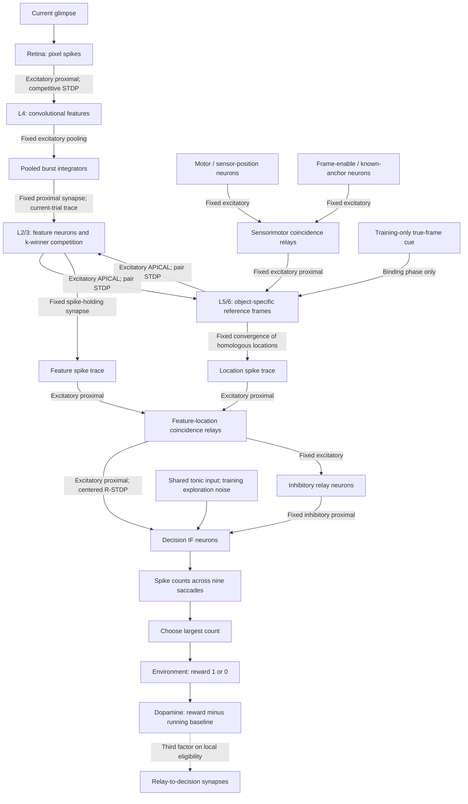

# Structure and decision rule

The final class comes only from decision-neuron spike counts. Features and
locations contribute through neuronal inputs; neither a location index nor a
target label enters the decision synapse's learning rule.

## Diagram

The neuronal boxes are PymoNNtorch NeuronGroups in one CoNeX Neocortex; the
connections are SynapseGroups. Holding synapses retain only the current trial's
activity between phases. No offline feature cache is used.

Caltech uses 25 learned 11×11 kernels and 5×5 pooling: 625 L2/3 features.
There are two reference frames. Each retains 26 cells: nine object sites,
16 surrounding sites and one background cell. This protocol visits the nine
object sites. There are 9×625 decision relays, matching inhibitory relays,
and two output neurons.

## Connection types

| Connection | Sign / compartment | Learning |
|---|---|---|
| Retina → L4 | Excitatory, proximal | Competitive kernel STDP |
| L4 → pool → L2/3 | Excitatory, proximal | Fixed pooling/transmission |
| Motor and frame-enable → relays → L5/6 | Excitatory, proximal | Fixed coincidence wiring |
| L5/6 → L2/3 | Excitatory, apical | Local pair STDP + outgoing normalization |
| L2/3 → L5/6 | Excitatory, apical | Local pair STDP + outgoing normalization |
| Feature/location traces → decision relays | Excitatory, proximal | Fixed transmission |
| Decision relays → decision neurons | Excitatory, proximal | Centered R-STDP |
| Decision relays → inhibitory relays | Excitatory | Fixed one-to-one |
| Inhibitory relays → decision neurons | Inhibitory, proximal | Fixed balancing inhibition |

L4 and L2/3 competition are reduced competition behaviors, not separately
modeled interneurons. Decision balancing inhibition has explicit inhibitory
neurons. Depressing an apical weight reduces excitation; it does not turn that
synapse inhibitory.

## Feature learning and priming

Retinal spikes integrate in L4 before burst release. Pooling integrates those
released spikes. L2/3 receives proximal sensory drive plus apical priming and
applies thresholding and k-winner competition.

The custom L4 rule is a window-based competitive STDP-like rule: presynaptic
spike accumulation and a postsynaptic release spike determine local weight
changes. Feature-usage homeostasis and kernel normalization control competition
and gain. This is a biological abstraction, not a detailed conductance model.

CoNeX bounds apical priming approximately by

\[
I_{apical,eff}=\tanh(I_{apical})\max[v_{rest}+p(\theta-v_{rest})-v,0].
\]

An active location makes associated features easier to activate, and an active
feature primes associated locations. Apical input alone remains subthreshold;
proximal input supplies the driving signal.

For each reciprocal synapse, pre/post traces first decay by \(e^{-1/2}\), then

\[
\Delta W_{ij}=0.001[x_i s_j-0.1s_i y_j],\qquad
x_i\leftarrow x_i+s_i,\quad y_j\leftarrow y_j+s_j.
\]

Thus earlier pre-spikes paired with current post-spikes potentiate, while the
reverse order depresses. Weights stay nonnegative and undergo outgoing
normalization. The authorized class-frame cue is used only during binding,
then removed before decision learning.

## Decisions from spikes

A feature-location relay has threshold 1.5 and receives unit excitation from
each input. It fires only when both are active. If its spikes are \(s_i\), the
decision neuron's balanced input is

\[
I_j=\operatorname{clip}\left[0.5+g\left(\sum_i w_{ij}s_i-
\tfrac12\sum_i s_i\right)+\xi_j,0,1\right].
\]

Plastic excitatory weights are \(w_{ij}\). The subtraction comes from the
fixed inhibitory pathway. Every class gets the same tonic input, 0.5.
\(\xi_j\) is label-independent exploration noise during training, zero in
evaluation. Non-leaky IF neurons then obey

\[
v_j\leftarrow v_j+I_j,\quad s_j=\mathbf1[v_j\ge1],\quad v_j\leftarrow v_j-s_j.
\]

Each fixation supplies 64 decision ticks. After nine fixations,

\[
N_j=\sum_t s_j(t),\qquad \hat c=\arg\max_j N_j.
\]

Training breaks equal-count ties randomly; evaluation uses the first maximum.
There is no softmax selection, separate location/feature score, or target
current forcing the correct output neuron to spike.

## Dopamine and centered R-STDP

Only the external training environment compares the emitted choice to the label:

\[
r=\mathbf1[\hat c=c_{true}],\qquad \delta=r-\bar r,\qquad
\bar r\leftarrow\bar r+0.01(r-\bar r).
\]

Each independent batched trial has one scalar dopamine value. The shared
baseline uses mean batch reward. There is no class-specific error vector.

Let \(x_i\) be the pre-spike trace, \(y_j\) the post-spike trace and \(z_j\)
the expected-firing trace. With \(\lambda=0.999\):

\[
x_i\leftarrow\lambda(x_i+s_i),\quad
y_j\leftarrow\lambda(y_j+s_j),\quad
z_j\leftarrow\lambda(z_j+\mu_j).
\]

\(\mu_j\) is the clipped noise-free input current of that same postsynaptic
neuron. It is a local expectation, not a label-derived target. Eligibility is

\[
e_{ij}\leftarrow\lambda e_{ij}+x_i(s_j-\mu_j)-0.1s_i(y_j-z_j).
\]

At delayed reward, eligibility decays once more and

\[
\Delta w_{ij}=\eta\,\delta\,e_{ij}.
\]

Independent trials are averaged; weights are clipped to [0,1]; consumed
eligibility is cleared. Feedback causes no extra sensory or decision spike.
The synapse Behavior reads only its own pre/post activity, local traces,
postsynaptic current and dopamine—not a location, label or unrelated population.

## Timing and biological scope

Sensory integration/release use native framework iterations. Constant-input
decision windows use exact event advancement: all threshold crossings are
retained, and the same local eligibility recurrence is integrated analytically.
Tests compare it with explicit tick equations. An event iteration advances a
full decision window, not one biological tick.

All plastic pathways update on arriving training batches, in separate sensory,
binding and decision phases. Fixed spatial wiring, phase scheduling,
within-trial activity holding, global competition, external reward and the
authorized frame cue remain explicit modeling assumptions. The accuracy checks
cover known-position classification; they do not establish complete biological
realism or revalidate shifted-object localization.
